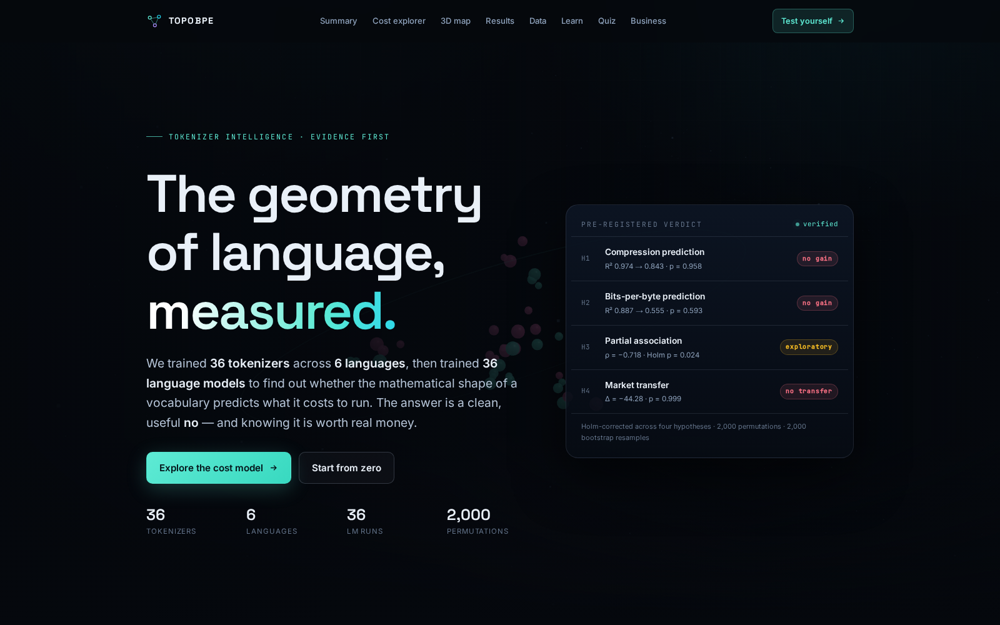
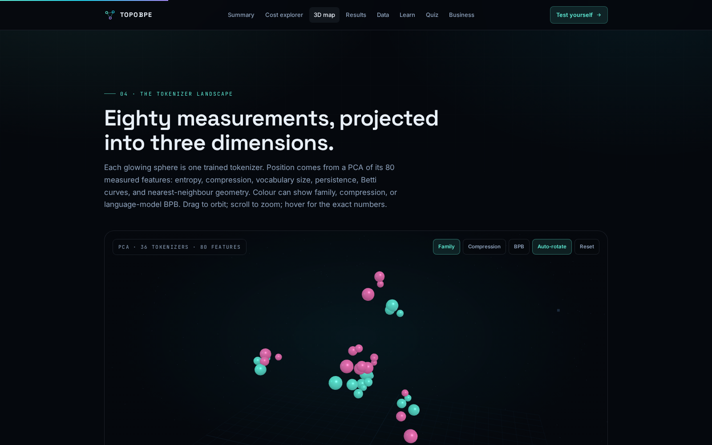
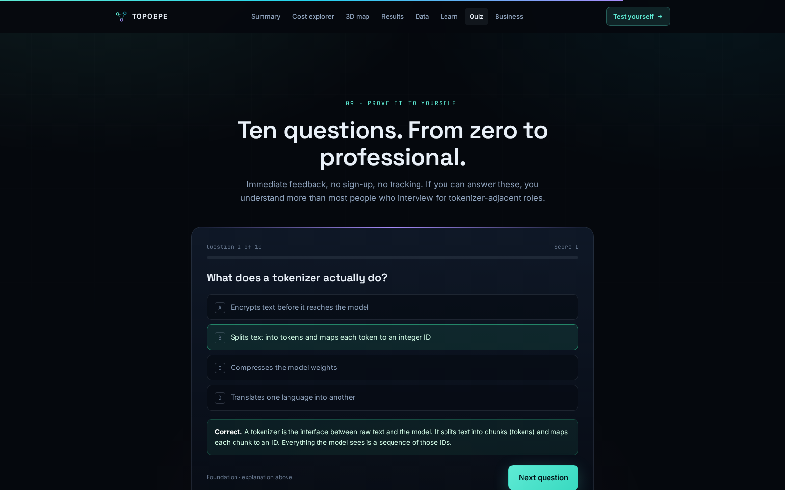
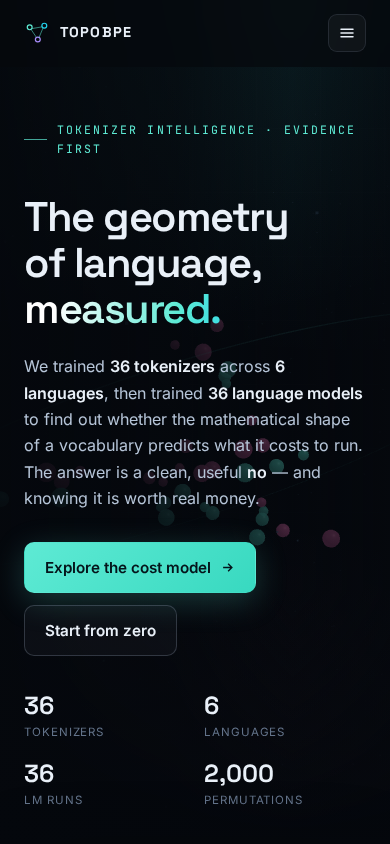
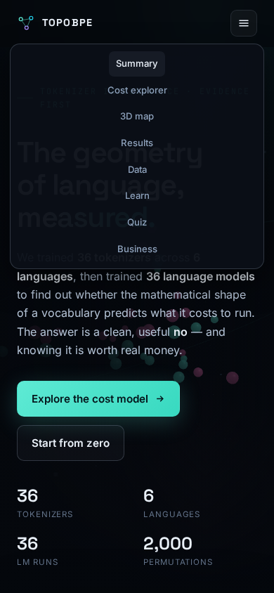

# TopoBPE

**Tokenizer intelligence, measured.**

> **Executive summary.** Every large language model pays a tokenizer tax. Tokens are the exchange rate between text and compute, and a tokenizer that compresses text 14% worse can raise input-serving cost by roughly 14% for identical traffic. Vendors and research teams justify tokenizer choices with vocabulary size, entropy, or increasingly sophisticated shape descriptors. We ran a pre-registered benchmark across **36 tokenizers, six corpora, 36 language models, 80 predictors, 2,000 permutations, and 2,000 bootstrap resamples** to test the strongest version of that claim: do persistent-homology descriptors of tokenizer geometry predict held-out compression or language-model bits-per-byte beyond eight cheap baselines? **The answer is no.** The eight-feature baseline reaches R² = 0.974 for compression and 0.887 for BPB; adding 72 topology descriptors lowers both. One exploratory partial association survives correction, but its confidence interval crosses zero. The deliverable is a trustworthy negative result, a reusable measurement harness, and an interactive explainer that takes a newcomer from zero to professional.

[](LICENSE)
[](pyproject.toml)
[](tests)
[](artifacts/manifest.json)

**Explore:** [Live interactive preview](https://m0-ar.github.io/the-topology-of-tokens-geometry/preview.html) · [Demo GIF](docs/assets/topobpe-demo.gif) · [Generated report](results/REPORT.md) · [Frozen protocol](docs/PROTOCOL.md)

**Extensions:** [Merge-topology experiments](docs/EXTENSIONS.md) · [Scaling calculator](calculator.html) · [TokenizerBench card](benchmark/BENCHMARK_CARD.md)

**All preview entry points work:** [site root](https://m0-ar.github.io/the-topology-of-tokens-geometry/) · [preview.html](https://m0-ar.github.io/the-topology-of-tokens-geometry/preview.html) · [docs/preview.html](https://m0-ar.github.io/the-topology-of-tokens-geometry/docs/preview.html).



## The 60-second tour

| Question | Short answer |
|---|---|
| What is this? | A complete, reproducible study of what actually predicts tokenizer economics. |
| What did you test? | Whether the mathematical shape of a tokenizer predicts held-out compression and BPB beyond simple statistics. |
| What did you find? | No out-of-corpus gain from topology. Eight cheap features already explain almost everything. |
| Why should I care? | It replaces tokenizer folklore with measured curves — and shows how to avoid paying for features that do not predict. |
| What is the asset? | The benchmark harness, the evidence trail, and the interactive explainer — not just the paper. |
| How do I see it? | Open [`preview.html`](https://m0-ar.github.io/the-topology-of-tokens-geometry/preview.html) or watch the [15-second demo](docs/assets/topobpe-demo.gif). |

**Headline numbers:** 36 tokenizers · 6 corpora · 36 language-model runs · 80 predictors · 2,000 permutations · 2,000 cluster-bootstrap resamples · 332 hashed artifacts · 0.695 GPU-hours of language-model training.

---

## 🌱 Beginner guide — read this and you are a professional

No prior maths, no tokenizer background, no hand-waving. Every idea is explained so plainly that even the most stubborn four-legged farm animal could follow it — no maths, no jargon, no gatekeeping.

**Let's work this out in a step-by-step way to be sure we have the right answer.**

### Step 1 — Text becomes tokens

A language model never sees letters. It sees integers. A **tokenizer** is the rulebook that turns text into chunks — common words, word fragments, punctuation, or single bytes — and maps each chunk to an integer ID. The model predicts the next ID; the tokenizer turns IDs back into text.

### Step 2 — The tokenizer sets the exchange rate

The same paragraph can become 100 tokens or 140 tokens depending on the tokenizer. More tokens mean more computation, more memory traffic, and usually more money. **Bytes per token** measures compression: how much text one token carries. Higher is cheaper for the same text.

### Step 3 — Compression is not the same as intelligence

A tokenizer can compress well and still be a bad choice. What matters is whether the model trained on those tokens predicts held-out text efficiently. The standard measure is **bits per byte (BPB)**: cross-entropy normalized by the number of bytes, so models with different vocabularies can be compared fairly. Lower BPB is better.

### Step 4 — What is the "shape" of a tokenizer?

Imagine every token as a point in space, placed by the contexts in which it appears. Some points form clusters; some form loops; some are isolated. **Persistent homology** is a branch of topology that records when those structures are born and when they disappear as you zoom out. A long-lived loop is a strong shape signal; a short-lived one is noise. The study turns those signals into 72 numeric descriptors.

### Step 5 — The fair test

It is easy to fit a complicated model to six data points and declare victory. This study uses **leave-one-corpus-out (LOCO)** prediction: train on five corpora, predict the sixth, repeat. It also uses **permutation tests** to ask whether the topology features do better than random labels, **cluster bootstrap** intervals to show uncertainty, and **Holm correction** to control false discoveries across four hypotheses. The protocol was frozen before the confirmatory models were trained.

### Step 6 — The answer

Eight simple statistics — vocabulary size, byte entropy, token entropy, conditional entropy, type-token ratio, gzip ratio, mean token bytes, and training compression — explain **97.4%** of held-out compression variance and **88.7%** of BPB variance. The 72 topology descriptors add no out-of-corpus predictive value. In LOCO evaluation they make predictions worse. One exploratory association survives correction, but its interval crosses zero, so it is reported as a signal worth studying — not a confirmed effect.

**You will know more than most interview candidates.** You can now explain why tokenizer quality is an economic measurement, why BPB is not the same as compression, why leave-one-corpus-out is the honest test, and why a well-run negative result is more valuable than a fragile positive one. Test yourself with the [10-question interactive quiz](https://m0-ar.github.io/the-topology-of-tokens-geometry/preview.html#quiz); every answer includes an explanation.

---

## What you can explore

The repository ships a complete, self-contained showcase — no sign-up, no tracking, no external API.

| Feature | What it does |
|---|---|
| **3D tokenizer map** | 36 tokenizers projected from 80 measured features into three dimensions with PCA. Orbit, zoom, hover for exact values, and recolor by family, compression, or BPB. |
| **Cost explorer** | Choose a corpus, tokenizer family, vocabulary size, monthly text volume, and price per million tokens. See tokens per gigabyte and the monthly bill update instantly. |
| **Results dashboard** | Verdict cards, confidence intervals, Holm-adjusted p-values, per-corpus breakdowns, and downloadable tables. |
| **Beginner guide** | A searchable, plain-language path from "what is a token?" to "what is a permutation test?" |
| **10-question quiz** | Immediate feedback and explanations. Designed to take a motivated beginner to interview-ready fluency. |
| **Glossary** | Searchable definitions for tokens, BPE, Unigram, entropy, persistent homology, LOCO, bootstrap, permutations, Holm correction, and more. |
| **Business section** | How platform teams, finance, procurement, research, and multilingual product teams can use the result. |
| **Evidence trail** | Every number traces to `results/analysis.json`, a table, a figure, or a hashed artifact. |
| **Downloadable figures** | Six publication-quality figures in PDF and PNG. |
| **Full pipeline** | Corpus download, tokenizer training, feature extraction, LM training, market runs, statistics, figures, and manifest. |

### Who this is for

| Audience | What you get |
|---|---|
| **Executives and product leaders** | A clear, quantified answer to "should we invest in this?" and a way to size tokenizer-driven serving cost. |
| **ML engineers and AI platform teams** | A reusable harness for comparing tokenizers on held-out bytes-per-token and BPB, with byte-reversibility audits. |
| **Researchers and reviewers** | A frozen protocol, pre-registered hypotheses, execution deviations, permutation/bootstrap inference, TDA library agreement, and a hashed manifest. |
| **Finance and procurement** | A defensible cost model that translates tokenizer quality into tokens per gigabyte and dollars per month. |
| **Students and career switchers** | A beginner guide, quiz, glossary, and a real applied-research artifact to discuss in interviews. |
| **Multilingual product teams** | Evidence that the same vocabulary budget behaves very differently across scripts — a product-cost issue, not a footnote. |
| **Model and data vendors** | A neutral third-party reference for tokenizer-efficiency claims. Publish measured curves instead of one-number marketing comparisons. |

---

## What we tested

| Item | Value |
|---|---|
| Corpora | `wikitext_en`, `codeparrot_py`, `wikipedia_zh`, `wikipedia_hu`, `wikipedia_ar`, `wikipedia_sw` |
| Documents | 12,000 eligible per corpus; roughly 9.5–9.6k train / 1.2k validation / 1.2k test |
| Tokenizers | BPE and Unigram × vocab 8,192 / 16,384 / 32,768 × 6 corpora = **36** |
| Language models | BPE only, 3 vocabulary sizes × 2 seeds (13, 37) × 6 corpora = **36 runs** |
| LM architecture | 6-layer decoder, `d_model=256`, 8 heads, `d_ff=1024`, context 1,024, 1,500 steps, 13.4M parameters |
| Baseline features | 8: actual vocabulary size, byte entropy, token entropy, conditional entropy, type-token ratio, gzip ratio, mean token bytes, training compression |
| Topology features | 72: H0/H1 persistence summaries, persistence entropy, Betti curves/counts for a 256-token cosine-distance cloud and a 256-token co-occurrence graph |
| Evaluation | Leave-one-corpus-out prediction, 2,000 cluster-bootstrap resamples, 2,000 permutations, Holm correction across H1–H4 |
| Market data | 12 US equities, 10 years of daily bars (2016–2026); 24 intraday windows excluded because the provider was unavailable |
| Runtime | 36 tokenizers (~18 min), 36 feature extractions (~36 min), 36 BPB runs (**0.695 GPU-hours**, median 70 s/run), plus market and analysis stages |
| Artifacts | **332** files hashed in [`artifacts/manifest.json`](artifacts/manifest.json) |

The unit of analysis is a tokenizer fitted to a corpus. Every predictive feature is computed from training material only; the test split is never used as a feature. The protocol was frozen before confirmatory model training. Five executed deviations are recorded in [`docs/PROTOCOL.md`](docs/PROTOCOL.md#execution-deviations), none of which changes a confirmatory decision rule.

---

## What we found

### At a glance

| Hypothesis | Baseline R² | Baseline + topology R² | Change | Test | Verdict |
|---|---:|---:|---:|---|---|
| **H1 — held-out tokenizer compression** | **0.974** | 0.843 | −0.131 | permutation p = 0.958 | **No gain** |
| **H2 — language-model BPB** | **0.887** | 0.555 | −0.332 | permutation p = 0.593 | **No gain** |
| **H3 — partial association** | — | — | ρ = −0.718 | raw p = 0.0015; Holm p = 0.024 | **Exploratory only** |
| **H4 — market transfer** | negative | more negative | Δ = −44.28 (compression) | bootstrap p = 0.999 | **No transfer** |

Topology-only models are worse still: R² = −0.767 for compression and 0.118 for BPB. The full model is not "close" — it is materially worse than eight cheap features.

### H1 — held-out tokenizer compression (bytes per token)

| Model | R² | MAE | Cluster-bootstrap 95% CI for R² |
|---|---:|---:|---|
| Baseline (8 features) | **0.974** | 0.135 | [0.787, 0.990] |
| Topology only (72 features) | −0.767 | 0.925 | [−6.148, −0.214] |
| Full (80 features) | 0.843 | 0.307 | [0.003, 0.899] |

Adding topology lowers R² by 0.131. Permutation test on the improvement: ΔR² = −0.131, p = 0.958; bootstrap p(Δ ≤ 0) = 0.990.

### H2 — language-model bits-per-byte

| Model | R² | MAE | Cluster-bootstrap 95% CI for R² |
|---|---:|---:|---|
| Baseline (8 features) | **0.887** | 0.091 | [−0.391, 0.942] |
| Topology only (72 features) | 0.118 | 0.227 | [−14.811, 0.787] |
| Full (80 features) | 0.555 | 0.166 | [−6.011, 0.866] |

Adding topology lowers R² by 0.332. Permutation p = 0.593; bootstrap p(Δ ≤ 0) = 0.996. The wide baseline interval reflects only six clusters.

### H3 — the one exploratory survivor

After controlling for compression, only `cooc_h1_total_persistence` survives Holm correction across the four tested variables: ρ = −0.718, raw p = 0.0015, Holm-adjusted p = 0.024. Its cluster-bootstrap 95% CI is [−0.877, 0.113] — it includes zero. With 18 rows and six clusters, this is a mechanistic hint, not a confirmed effect.

### H4 — no market transfer

A public-corpus model predicting absolute market-scale targets is far out of distribution.

| Target | Baseline R² | Full R² | ΔR² (full − baseline) | Bootstrap p(Δ ≤ 0) |
|---|---:|---:|---:|---:|
| Market compression | −26.02 | −70.30 | −44.28 [−92.97, −20.37] | 0.999 |
| Market BPB | −9.89 | −18.31 | −8.42 [−66.46, −4.96] | 1.000 |

An exploratory within-market LOCO model is also negative for both targets (best full R² = −0.214 for compression; BPB full R² = −0.546). **No market-transfer or trading claim is made.**

### Holm correction

| Hypothesis | Raw p | Adjusted p |
|---|---:|---:|
| H1 | 0.958 | 1.000 |
| H2 | 0.593 | 1.000 |
| H3 | 0.006 | **0.024** |
| H4 | 1.000 | 1.000 |

All numbers above come from the fixed analysis run in [`results/analysis.json`](results/analysis.json). The human-readable report is [`results/REPORT.md`](results/REPORT.md).

---

## Beyond the null: scale-aware geometry

The original study asked whether topology transfers **across corpora**. It does not. A follow-up asked a narrower question: does the **merge construction** of a BPE vocabulary predict how compression changes with vocabulary size inside a corpus? On the frozen data, yes:

- **Unseen vocabulary size:** adding ten pre-registered merge-topology features to a cubic size baseline raises R² from 0.575 to 0.934 (Δ = +0.359, 95% CI [0.196, 0.705], permutation p = 0.008).
- **Extrapolation to 32k** (trained on 512–16k): R² = 0.680 versus −0.004 for the size baseline. Downward to 512: 0.379 versus ≈0.
- **Cross-corpus transfer still fails:** every leave-one-corpus-out comparison is negative, including a 3-component PCA of the same features.

This is a scale-planning result, not a universal tokenizer score. The all-feature model overfits catastrophically under LOCO; the report keeps that failure visible. Read the full methods, nulls and caveats in **[docs/EXTENSIONS.md](docs/EXTENSIONS.md)**, try the **[calculator](calculator.html)**, or use the **[benchmark package](benchmark/BENCHMARK_CARD.md)**.

## Why this negative result is valuable

A negative result is only useful if it is trustworthy and reusable. This one is both.

**For AI platform teams.** Replace tokenizer folklore with held-out bytes-per-token curves. Choose vocabulary size per language and measure downstream BPB instead of guessing from vocabulary count. The eight-feature baseline is a high bar: any new tokenizer feature should have to beat R² = 0.974 out of corpus.

**For finance and procurement.** A tokenizer with 14% worse compression can raise input-serving cost by roughly 14% for identical text at a fixed per-token price. On a $1M annual inference budget, that is about $140k. The explorer gives a defensible range and shows which assumption drives the number. It is an illustrative mapping, not a price quote — always map the measurement onto your actual contract.

**For research and due diligence.** A pre-registered negative result with a frozen protocol, permutation tests, bootstrap intervals, library agreement, and a hashed manifest can be cited instead of re-running the same dead end. It also protects teams from shipping sophisticated features that quietly degrade out-of-corpus performance.

**For model and data vendors.** Use the harness as a neutral reference for tokenizer-efficiency claims. Publish measured curves, not adjectives.

**The business case in one paragraph.** A measurement harness that costs an afternoon can prevent a quarter of speculative feature engineering. It turns a technical argument into a cost argument, and it gives every stakeholder the same number to argue about.

---

## See it in motion


| 3D tokenizer map | Interactive quiz |
|---|---|
|  |  |

The preview is responsive and keyboard-accessible. On mobile, the navigation collapses into a menu and the charts reflow.

| Mobile hero | Mobile menu |
|---|---|
|  |  |

**Open the preview:** use the [site root](https://m0-ar.github.io/the-topology-of-tokens-geometry/), [`preview.html`](https://m0-ar.github.io/the-topology-of-tokens-geometry/preview.html), or the [`docs/preview.html` mirror](https://m0-ar.github.io/the-topology-of-tokens-geometry/docs/preview.html). Each `index.html` redirects to its local `preview.html`, so all three paths render the same showcase.

---

## Reproduce it

```bash
# Install the pinned environment
make install

# Run the test suite
make test

# Tiny CPU-only smoke run (minutes)
make smoke

# Full reported pipeline (GPU recommended for the LM stage)
bash scripts/reproduce.sh configs/default.yaml
```

Docker is supported for both CPU and GPU:

```bash
docker compose run --rm topobpe-cpu all --config configs/default.yaml
docker compose --profile gpu run --rm topobpe-gpu all --config configs/default.yaml
```

Individual stages: `download`, `tokenizers`, `features`, `lm`, `market-data`, `market-features`, `market-lm`, `analysis`, `figures`, `manifest`. See [`docs/REPRODUCIBILITY.md`](docs/REPRODUCIBILITY.md) for seeds, environment details, and hardware notes.

The reported run used one RTX 3090 for 0.695 GPU-hours of language-model training. Tokenizer training and feature extraction are CPU-bound. The market stage runs on CPU. The full pipeline is deterministic given the pinned environment, recorded seeds, and frozen configuration.

Rebuild the interactive page after changing results or site sources:

```bash
.venv/bin/python scripts/build_site.py
```

---

## Trust and evidence

This is not a one-off notebook. Every claim has a paper trail.

- **Pre-registered protocol.** Hypotheses, decision rules, and evaluation plans were frozen before confirmatory training. Executed deviations are documented, not hidden: [`docs/PROTOCOL.md`](docs/PROTOCOL.md).
- **Data card.** Provenance, splits, filtering, and known limitations: [`docs/DATA_CARD.md`](docs/DATA_CARD.md).
- **Methodology audit.** A 2025–2026-style review of leakage, multiplicity, and inference: [`docs/METHODOLOGY_AUDIT.md`](docs/METHODOLOGY_AUDIT.md).
- **Independent TDA check.** Ripser and GUDHI agree on all 24 corpus × cloud × dimension comparisons, with bottleneck distance ≤ 2.4 × 10⁻⁷ under a 10⁻⁶ tolerance: [`results/tables/tda_library_agreement.csv`](results/tables/tda_library_agreement.csv).
- **Byte-reversibility audit.** All 18 BPE tokenizers reconstruct held-out text exactly; 12 of 18 Unigram tokenizers do. The six exceptions contain `<unk>` tokens. Every condition is in [`results/tables/tokenizer_byte_audit.csv`](results/tables/tokenizer_byte_audit.csv).
- **Bug found and fixed.** A permutation-test slicing bug was discovered during the final audit, fixed, covered by a regression test, and the analysis was re-run from cached features. All numbers here come from the fixed run.
- **Seed and scale checks.** BPB standard deviation across seeds is at most 0.007. Point-count sensitivity is reported honestly: persistence summaries are scale-dependent, so absolute descriptor magnitudes should not be compared across studies.
- **Hashed manifest.** 332 artifacts with SHA-256 hashes, environment details, and the config hash: [`artifacts/manifest.json`](artifacts/manifest.json).
- **Tests.** 22 tests pass; `ruff` is clean; Docker Compose configuration is verified.

### What this does not claim

- It does not claim persistent homology is useless everywhere. It claims these descriptors are not a **transferable predictive signal** for this decision, at this scale, under this sampling design.
- It does not claim BPB is the only measure of tokenizer quality. Downstream accuracy, fairness, latency, and inference cost are separate questions.
- It does not claim the market result is a trading strategy. The market analysis is a negative external validation.
- It does not claim the result generalizes to much larger models. The main language models are 13.4M parameters and trained for 1,500 steps; the conclusion is scale-local.

---

## FAQ

**So topology is useless for tokenizers?** Not in general — useless for this prediction problem, under this protocol. Persistent homology is a legitimate tool for shape analysis. Here, 72 topology descriptors failed to improve out-of-corpus prediction beyond eight cheap statistics, and they degraded it.

**Why publish a negative result?** Because teams are already spending engineering time on sophisticated tokenizer features without a benchmark. A pre-registered negative result with 2,000 permutations and a public artifact trail prevents repeated dead ends.

**Does a lower BPB always mean lower cost?** No. BPB measures next-byte prediction; API pricing is per token. The bridge is bytes per token. A tokenizer with better compression can still be more expensive if the provider prices tokens differently or caches aggressively.

**Why were only BPE tokenizers used for language models?** Production decoder-only LLMs overwhelmingly use BPE. Training 36 additional Unigram language models would have doubled GPU cost without changing the primary hypothesis. Unigram rows still have compression and the full 80-feature set.

**Can I use this with my own corpus?** Yes. Point the config at a text corpus, train tokenizers with the provided CLI, extract features, and run the same analysis. The smoke profile runs on CPU in minutes; the full profile needs a GPU for the language-model stage.

**What is the single most important number?** 0.974. That is the leave-one-corpus-out R² of the eight-feature baseline for held-out compression. Any added feature set has to beat it out of corpus.

---

## Repository map

| Path | Contents |
|---|---|
| `src/topobpe/` | Pipeline: data, tokenizers, features, LM training, market runs, statistics, figures, CLI |
| `configs/` | Frozen default configuration and CPU smoke profile |
| `docs/PROTOCOL.md` | Hypotheses, decision rules, execution deviations |
| `docs/DATA_CARD.md` | Corpus provenance, splits, audits |
| `docs/METHODOLOGY_AUDIT.md` | Leakage, multiplicity, and inference review |
| `docs/REPRODUCIBILITY.md` | Environment, seeds, commands, Docker |
| `results/analysis.json` | Single source of truth for every reported number |
| `results/REPORT.md` | Auto-generated human-readable report |
| `results/tables/` | Predictions, BPB summary, H3, H5, TDA agreement, byte audit |
| `results/figures/` | Six publication figures in PDF and PNG |
| `site/` | Source parts for the interactive preview |
| `preview.html` | Generated showcase: 3D map, explorer, quiz, glossary, business case |
| `index.html` | Meta-refresh redirect to `preview.html` |
| `scripts/` | Reproduce, build site, byte audit, TDA stability, download, report |
| `tests/` | 22 tests, including the permutation slicing regression and the extension checks |
| `artifacts/manifest.json` | SHA-256 hashes for 332 artifacts |
| `Dockerfile`, `docker-compose.yml`, `Makefile` | CPU/GPU reproducibility entry points |
| `CITATION.cff`, `LICENSE` | Citation metadata and MIT license |

---

## Cite this work

```bibtex
@software{topobpe2026,
  title  = {TopoBPE: Topological Signatures of Byte-Pair Encodings},
  author = {TopoBPE contributors},
  year   = {2026},
  version = {0.1.0},
  note   = {Pre-registered benchmark and reproducible analysis}
}
```

Citation metadata is also available in [`CITATION.cff`](CITATION.cff). If you use the benchmark, please cite the software and link the generated report.

## License

Code is released under the MIT License — see [`LICENSE`](LICENSE). Derived data and text follow the upstream dataset terms listed in the data card and are not redistributed.

---

**Built to be checked.** If a number here cannot be traced to a file, a table, or a hashed artifact, treat it as a bug and open an issue.
